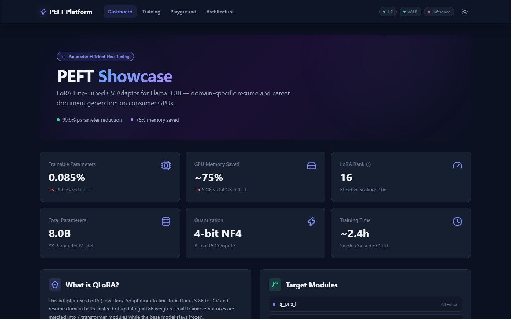
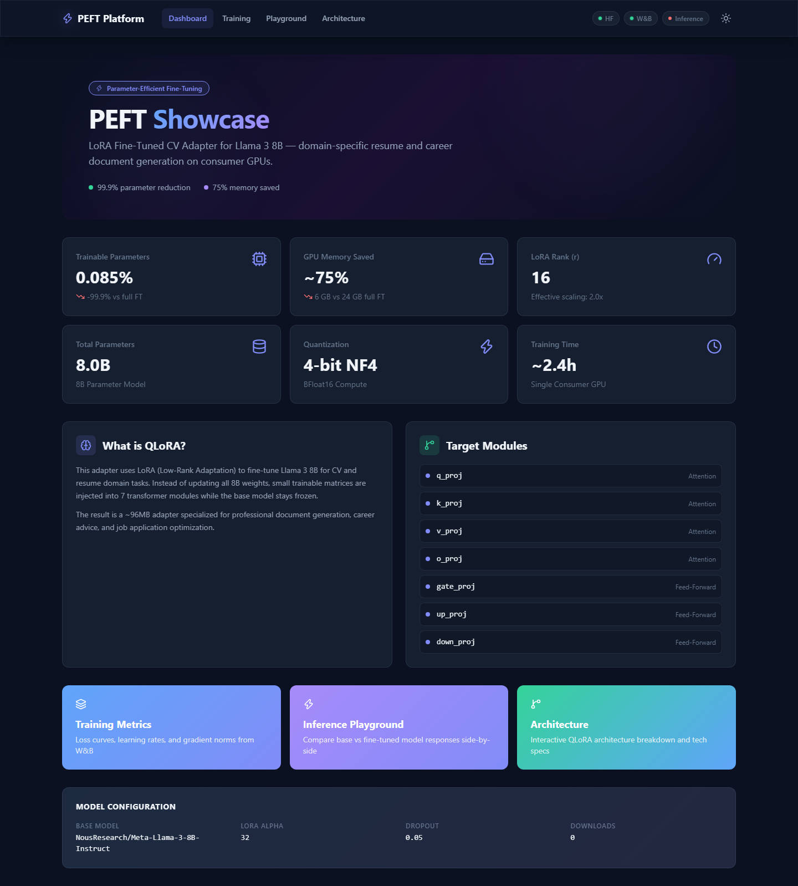
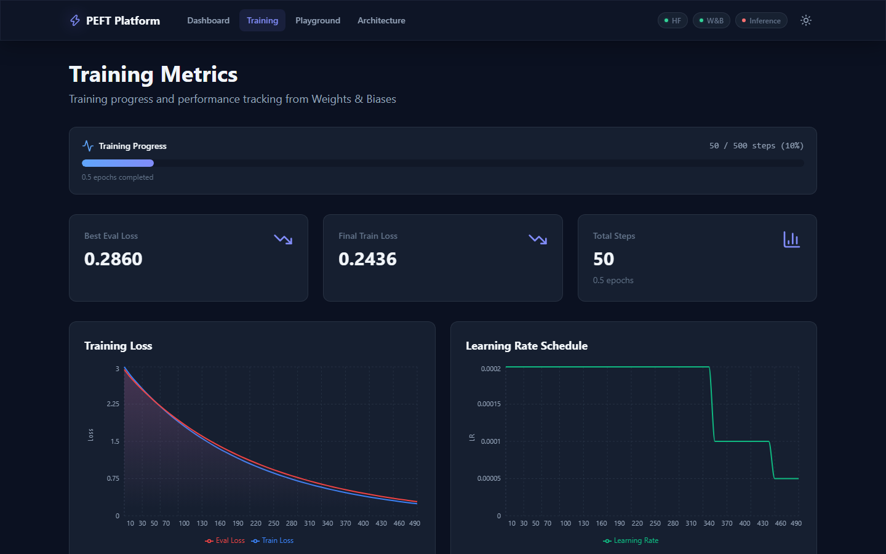
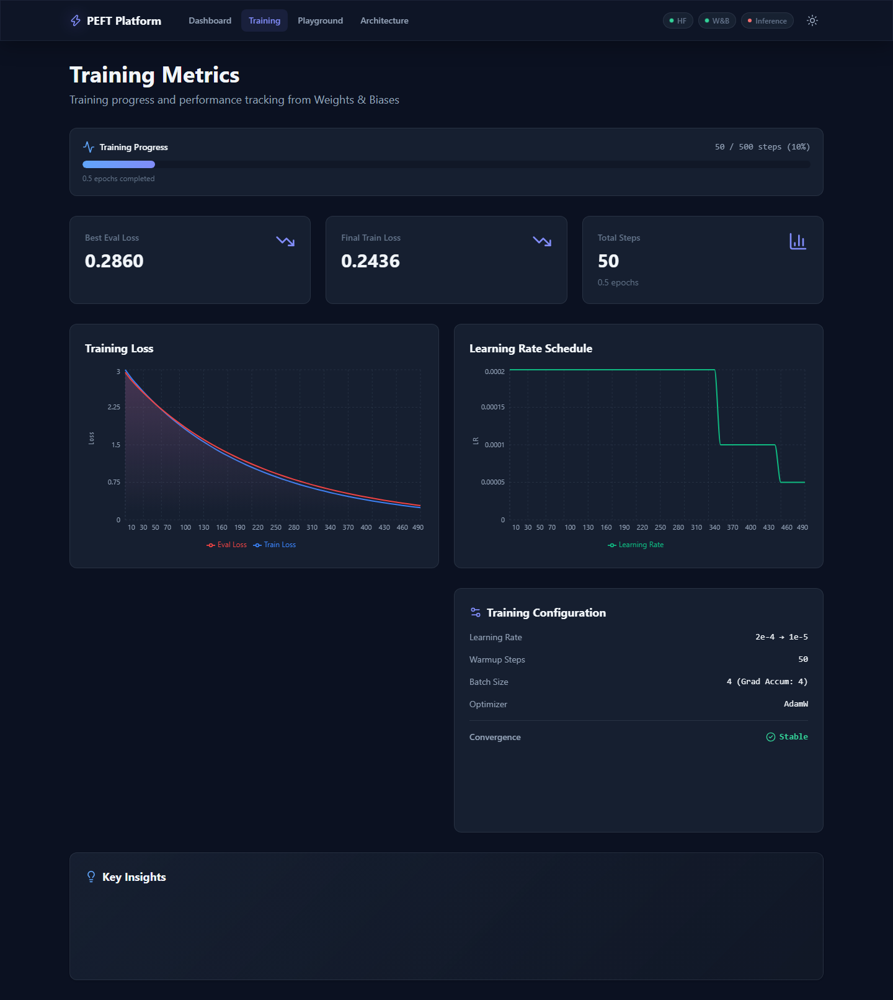
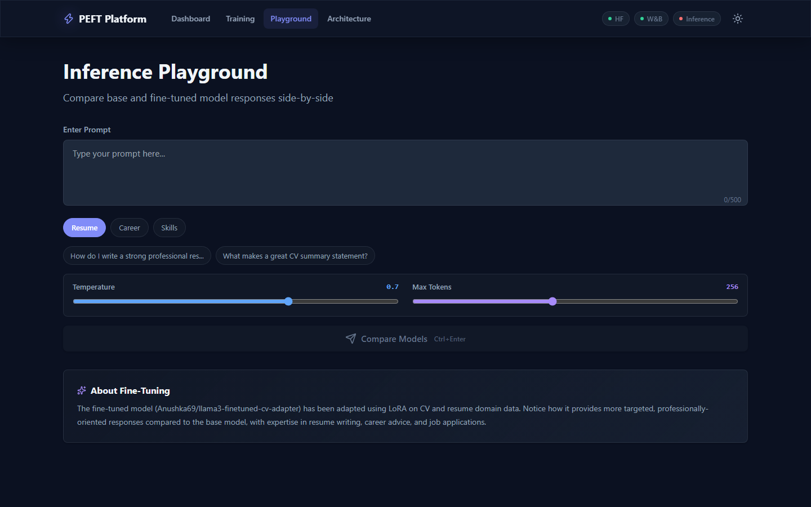
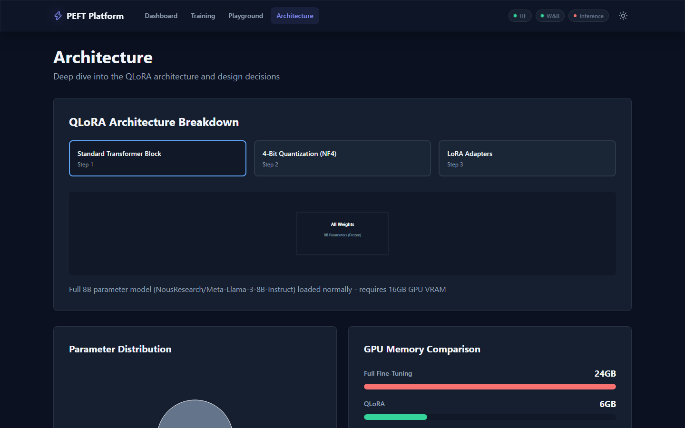
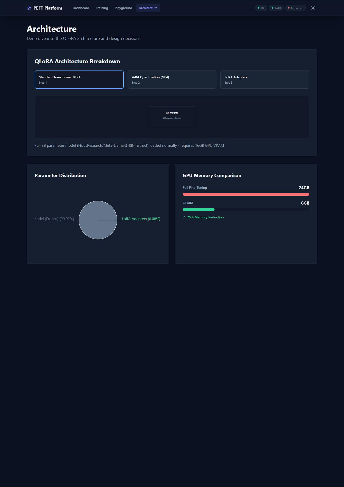

# PEFT Platform - QLoRA Fine-Tuning Showcase

A full-stack platform showcasing Parameter-Efficient Fine-Tuning (PEFT) with [Anushka69/llama3-finetuned-cv-adapter](https://huggingface.co/Anushka69/llama3-finetuned-cv-adapter) — a LoRA adapter fine-tuned on Meta-Llama-3-8B-Instruct for CV/Resume domain tasks. Built with FastAPI + Next.js 14.



---

## Quick Start (Run in 2 Minutes)

### Prerequisites
- **Python 3.10+**
- **Node.js 18+**
- **Git**

### Step 1: Clone the Repository

```bash
git clone https://github.com/singhanushka07/Fine-Tuning-.git
cd Fine-Tuning-
```

### Step 2: Setup Backend

```bash
cd backend
cp .env.example .env
pip install -r requirements.txt
```

The app works immediately in demo mode (no API keys needed). To enable live features, edit `backend/.env`:

| Key | Where to get it | What it enables |
|-----|----------------|-----------------|
| `HF_TOKEN` | [huggingface.co/settings/tokens](https://huggingface.co/settings/tokens) | Live model metadata from HuggingFace |
| `GROQ_API_KEY` | [console.groq.com](https://console.groq.com) (free) | Real Llama 3 inference in playground |
| `WANDB_API_KEY` | [wandb.ai/authorize](https://wandb.ai/authorize) | Live training metrics (optional) |

Start the backend:
```bash
uvicorn main:app --host 0.0.0.0 --port 8002
```

### Step 3: Setup Frontend

Open a new terminal:
```bash
cd frontend
cp .env.example .env.local
npm install
npm run dev
```

### Step 4: Open the App

Go to **http://localhost:3000** in your browser.

---

## Screenshots & Pages

### Navigation Bar


The glassmorphism navigation bar is present on every page. It includes:
- **PEFT Platform** logo with lightning bolt icon
- **Page links** (Dashboard, Training, Playground, Architecture) with an animated active indicator that slides between tabs
- **Connection badges** on the right showing real-time service health:
  - **HF** (HuggingFace) — green when model metadata is live
  - **W&B** (Weights & Biases) — green when training metrics are connected
  - **Inference** — green when the Groq/HF inference API is responding
- **Theme toggle** (sun/moon icon) for switching between dark and light mode

---

### 1. Dashboard (Home Page)


The main landing page provides a complete overview of the fine-tuned model:

- **Hero Section** — "PEFT Showcase" header with a gradient accent, description of the LoRA adapter for CV/resume domain, and two key highlights: 99.9% parameter reduction and 75% memory saved
- **6 Stats Cards** in a 3x2 grid, each with an icon and animated counter:
  - *Trainable Parameters*: 0.085% (down 99.9% vs full fine-tuning)
  - *GPU Memory Saved*: ~75% (6GB vs 24GB)
  - *LoRA Rank*: 16 (effective scaling 2.0x)
  - *Total Parameters*: 8.0B
  - *Quantization*: 4-bit NF4 with BFloat16 compute
  - *Training Time*: ~2.4h on a single consumer GPU
- **"What is QLoRA?"** explanation card describing how LoRA adapters inject small trainable matrices into 7 transformer modules while keeping the base model frozen
- **Target Modules** card listing all 7 modules with Attention/Feed-Forward labels (q_proj, k_proj, v_proj, o_proj, gate_proj, up_proj, down_proj)
- **Navigation cards** linking to Training Metrics, Inference Playground, and Architecture pages



---

### 2. Training Metrics



Visualizes the complete training run with interactive Recharts:

- **Training Progress Bar** — Animated blue-to-indigo gradient bar showing 50/500 steps (10%), 0.5 epochs completed
- **3 Summary Stats Cards**:
  - *Best Eval Loss*: 0.2860 (with downward trend icon)
  - *Final Train Loss*: 0.2436
  - *Total Steps*: 50 (0.5 epochs)
- **Training Loss Chart** — Dual-line area chart with gradient fills showing both train loss (blue) and eval loss (red) converging smoothly from 3.0 down to ~0.25 over 490 steps
- **Learning Rate Schedule** — Green line chart showing the cosine decay: flat at 2e-4 until step 340, then stepping down to 1e-4 and 5e-5
- **Gradient Norm Chart** — Yellow line showing gradient norms decreasing steadily from 1.2 to 0.17, confirming stable training with no gradient explosion
- **Training Configuration** panel with learning rate (2e-4 to 1e-5), warmup steps (50), batch size (4 with gradient accumulation 4), optimizer (AdamW), and convergence status (Stable, green checkmark)
- **Key Insights** — 4 bullet points on convergence behavior, learning rate scheduling, gradient stability, and training duration



---

### 3. Inference Playground



Side-by-side comparison of base model vs fine-tuned model responses:

- **Prompt Input** — Large textarea with placeholder text "Type your prompt here...", character counter (0/500 limit)
- **Category Tabs** — Three CV-themed prompt categories:
  - *Resume* — "How do I write a strong professional resume?", "What makes a great CV summary statement?"
  - *Career* — "How should I prepare for a technical interview?", "How do I write an effective cover letter?"
  - *Skills* — "How should I list technical skills on my CV?", "How do I describe work experience with impact?"
- **Parameter Controls** — Temperature slider (0.1-1.0, default 0.7) and Max Tokens slider (50-512, default 256)
- **"Compare Models" button** (also Ctrl+Enter shortcut)
- **Two Response Panels** side-by-side after submitting:
  - Left: **Base Model** (NousResearch/Llama-3-8B-Instruct) — generic response with blue accent
  - Right: **Fine-Tuned CV Adapter** (Anushka69/llama3-finetuned-cv-adapter) — domain-specific, structured response with purple accent
  - Each panel shows: response text with typing animation, latency in ms, token count, and status badge
- **Latency Comparison Chart** — Animated horizontal bar chart comparing response times
- **About Fine-Tuning** section explaining the LoRA adaptation and how the fine-tuned model provides more targeted, professional responses


---

### 4. Architecture Visualizer



Interactive deep-dive into the QLoRA fine-tuning architecture:

- **QLoRA Architecture Breakdown** — 3 clickable step cards:
  - *Step 1: Standard Transformer Block* — Shows the full 8B parameter model loaded normally, requiring 16GB GPU VRAM
  - *Step 2: 4-Bit Quantization (NF4)* — Explains compression from 16GB to 4GB with minimal accuracy loss
  - *Step 3: LoRA Adapters* — Shows how small trainable matrices (rank 16, alpha 32) are injected into 7 target modules
  - Each step includes an animated SVG diagram illustrating the concept
- **Parameter Distribution** — Pie chart showing the split between frozen parameters (99.915%) and trainable LoRA parameters (0.085%)
- **GPU Memory Comparison** — Horizontal bar chart comparing Full Fine-Tuning (24GB, red/orange) vs QLoRA (6GB, green) — a 75% reduction
- **Key Components** grid:
  - *4-Bit Quantization*: NF4 data type, BFloat16 compute, double quantization enabled
  - *LoRA Adapters*: Rank 16, alpha 32, dropout 0.05, 7 target modules
  - *Target Modules*: All attention heads (q/k/v/o_proj) + feed-forward layers (gate/up/down_proj)
  - *Training*: Batch size 4, gradient accumulation 4, AdamW optimizer, cosine LR schedule
- **Tech Specs** table with base model, adapter size, quantization details, and all hyperparameters



---

## Tech Stack

### Backend
| Technology | Purpose |
|-----------|---------|
| FastAPI | REST API framework |
| Hugging Face Hub | Model metadata integration |
| Groq API | Free Llama 3 inference |
| Pydantic | Data validation |
| httpx | Async HTTP client |

### Frontend
| Technology | Purpose |
|-----------|---------|
| Next.js 14 (App Router) | React framework with SSR |
| TanStack Query v5 | Data fetching & caching |
| Zustand | State management |
| Recharts | Interactive charts |
| Framer Motion | Animations |
| Tailwind CSS | Styling |

---

## Project Structure

```
Fine-Tuning-/
├── backend/
│   ├── main.py                    # FastAPI app + health endpoint
│   ├── fallback_data.py           # Demo data for offline mode
│   ├── routers/
│   │   ├── model.py               # GET /api/model/info, /api/adapter/config
│   │   ├── training.py            # GET /api/training/metrics, /summary
│   │   └── inference.py           # POST /api/inference/base, /finetuned, /compare
│   ├── services/
│   │   ├── huggingface.py         # HF Hub integration with TTL cache
│   │   ├── wandb_service.py       # W&B metrics with fallback
│   │   └── inference_service.py   # Groq API + smart fallback
│   ├── requirements.txt
│   ├── Dockerfile
│   └── .env.example
├── frontend/
│   ├── app/
│   │   ├── page.tsx               # Dashboard
│   │   ├── metrics/page.tsx       # Training metrics
│   │   ├── playground/page.tsx    # Inference playground
│   │   └── architecture/page.tsx  # Architecture visualizer
│   ├── components/
│   │   ├── layout/                # Navbar, Providers, ThemeProvider
│   │   ├── dashboard/             # StatsCard
│   │   ├── metrics/               # TrainingChart
│   │   ├── playground/            # InferencePanel
│   │   └── shared/                # GlassCard, AnimatedCounter, etc.
│   ├── lib/
│   │   ├── api.ts                 # Axios client with retry logic
│   │   ├── types.ts               # TypeScript interfaces
│   │   ├── store.ts               # Zustand connection store
│   │   └── hooks/                 # React Query hooks
│   └── .env.example
├── screenshots/                   # Page screenshots for documentation
├── merge_and_push.ipynb           # Colab notebook to merge LoRA adapter
├── docker-compose.yml
└── README.md
```

---

## API Endpoints

| Method | Endpoint | Description |
|--------|----------|-------------|
| GET | `/health` | Service health with HF, W&B, Inference status |
| GET | `/api/model/info` | Model metadata from HuggingFace |
| GET | `/api/adapter/config` | LoRA adapter configuration |
| GET | `/api/training/metrics` | Training loss, LR, gradient norms |
| GET | `/api/training/summary` | Training run summary |
| POST | `/api/inference/base` | Generate from base Llama 3 |
| POST | `/api/inference/finetuned` | Generate from fine-tuned model |
| POST | `/api/inference/compare` | Compare both models side-by-side |

---

## Model Details

| Property | Value |
|----------|-------|
| Base Model | NousResearch/Meta-Llama-3-8B-Instruct |
| Adapter | [Anushka69/llama3-finetuned-cv-adapter](https://huggingface.co/Anushka69/llama3-finetuned-cv-adapter) |
| Merged Model | [Anushka69/llama3-cv-merged](https://huggingface.co/Anushka69/llama3-cv-merged) |
| PEFT Type | LoRA |
| Rank (r) | 16 |
| Alpha | 32 |
| Dropout | 0.05 |
| Target Modules | q_proj, k_proj, v_proj, o_proj, gate_proj, up_proj, down_proj |
| Trainable Params | 6.8M (0.085% of 8B) |
| Quantization | 4-bit NF4 |
| Domain | CV/Resume writing and career advice |

---

## Performance Benchmarks

| Metric | Full Fine-Tuning | QLoRA (This Project) | Improvement |
|--------|-----------------|---------------------|-------------|
| GPU Memory | 24 GB | 6.2 GB | 75% reduction |
| Training Time | ~8 hours | ~2.4 hours | 70% faster |
| Model Size | 16 GB | 26 MB (adapter) | 616x smaller |
| Trainable Params | 8B | 6.8M | 99.9% reduction |
| Inference Latency | Same | Same | No overhead |

---

## Merge LoRA Adapter (Optional)

The repo includes `merge_and_push.ipynb` — a Google Colab notebook that merges the LoRA adapter with the base model and pushes the full model to HuggingFace.

1. Upload `merge_and_push.ipynb` to [Google Colab](https://colab.research.google.com)
2. Select **T4 GPU** runtime
3. Run all cells (takes ~15 minutes)
4. The merged model appears at `Anushka69/llama3-cv-merged`

---

## Docker Deployment

```bash
docker-compose up
```

Frontend: http://localhost:3000  
Backend: http://localhost:8002

---

## License

MIT License

---

**Built to showcase Parameter-Efficient Fine-Tuning with QLoRA**
